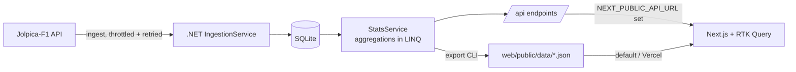

# Paddock Stats

Formula 1 championship analytics since 2014: how every title fight unfolded round by round, head-to-head driver comparisons, and circuit histories.

**Live demo:** https://kenn-f1-paddock-stats.vercel.app. Sign in with one click as a demo **Viewer**, **Analyst** or **Admin**.

- Season view: cumulative points by round for every driver or team, with hover/keyboard scrubbing, highlighting, and a table alternative
- Head-to-head (Analyst): race and qualifying battles, totals, and race-by-race diverging bars for any two drivers
- Circuit and driver histories; an Admin page with users and data refresh
- Role-based access: JWT in an httpOnly cookie (Next.js BFF), page gating in `proxy.ts`, and policy-based authorization in the .NET API

See [application-flow.md](application-flow.md) for flows, data flow, state and auth, and [memory.md](memory.md) for decisions and trade-offs.

| Layer | Stack |
| --- | --- |
| API | .NET 10 minimal APIs, EF Core + SQLite, typed `HttpClient` + resilience (Jolpica-F1), xUnit |
| Web | Next.js (App Router) + TypeScript, Redux Toolkit + RTK Query, Tailwind, d3-scale/d3-shape SVG charts |
| Tests | Vitest + React Testing Library, Cypress + axe |



## Live vs snapshot mode

The .NET API is the source of truth. Its `export` command writes every GET response to `web/public/data/<route>.json`
(`/api/seasons/2021` → `/data/seasons/2021.json`). The web app's RTK Query `baseQuery` reads from the API when
`NEXT_PUBLIC_API_URL` is set and from that snapshot otherwise. Vercel can't host .NET, so the public demo runs in snapshot mode;
locally you can run it against the live API.

## Run with Docker (live mode)

```bash
docker compose up --build      # web http://localhost:3102, API http://localhost:5102 (docs at /scalar/v1)
```

The API starts from the committed seed database (no Jolpica calls at boot) on a named volume, and the web app runs in live mode
through its `/api/live` proxy. Set `AUTH_SECRET` in a `.env` file to override the shared demo JWT secret.

## Run locally

```bash
# API (http://localhost:5102, docs at /scalar/v1). Starts from the committed seed DB.
cd api && ASPNETCORE_URLS=http://localhost:5102 dotnet run --no-launch-profile

# Refresh data from Jolpica, then re-export the snapshot
dotnet run --project api -- ingest 2014 2026
dotnet run --project api -- export web/public/data

# Web (snapshot mode)
cd web && npm install && npm run dev
# Web (live mode)
NEXT_PUBLIC_API_URL=http://localhost:5102 npm run dev
```

## Tests

The test pyramid, bottom up:
- **xUnit**: the pure `StatsCalculator`, run against the committed snapshot (computed standings must equal the official totals), plus
  `WebApplicationFactory` tests for 401/403 on protected endpoints.
- **Vitest + Testing Library**: reducers, memoized selectors, URL-state parsing, role/permission rules, head-to-head math, colour
  contrast, and the combobox's keyboard behaviour. Tests query by role and label, like a user would.
- **Cypress + axe**: main flows (season controls, head-to-head, circuits) and role gating, against `next start` in snapshot mode so
  runs are deterministic; every key page must pass axe with no serious or critical violations.

```bash
dotnet test                      # xUnit: standings math reconciled against official totals
cd web && npm test               # Vitest: reducers, selectors, URL state, h2h logic, combobox
cd web && npm run build && npm run e2e:ci   # Cypress against `next start` (snapshot mode), with axe checks
```

Unofficial fan project. Data: Jolpica-F1 (Ergast-compatible). Not affiliated with Formula 1 or the FIA.
