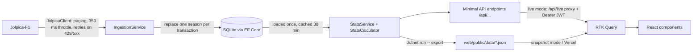
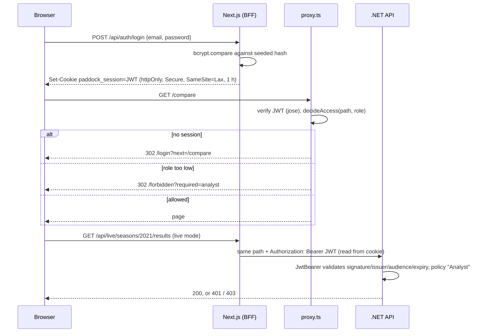

# Application flow

## Pages and who can use them

| Route | What it shows | Min. role |
| --- | --- | --- |
| `/login` | One-click demo accounts + form | public |
| `/` | Every season as a card with a title-fight sparkline | Viewer |
| `/season/[year]` | Championship progression chart, standings, race-by-race winners | Viewer |
| `/circuits`, `/circuits/[id]` | Circuit list (search/sort) and history: winners, pole-to-win rate, wins by team | Viewer |
| `/drivers`, `/drivers/[id]` | Driver list and career (finish per season, teammates) | Viewer |
| `/compare?a=&b=&from=&to=` | Head-to-head: race + qualifying battles, totals, race-by-race diverging bars | Analyst |
| `/admin` | Users and roles; refresh a season (live mode only) | Admin |
| `/forbidden` | 403 page naming the role required | public |

## Main user flows

1. **Explore a season.** Home → season card → chart. Hover or use arrow keys to scrub rounds; click a line, label or standings row to
   highlight a driver. Switch Drivers/Teams, top 5/10/all, or Chart/Table (an accessible table alternative).
   The highlight survives season switches, so you can follow one driver from year to year.
2. **Compare two drivers** (Analyst). Pick drivers with the keyboard-accessible combobox, or a rivalry/teammate quick pick, then narrow
   the season range. The selection is in the URL, so the link can be shared and Back works.
3. **Jump between views.** A highlighted driver links to "Compare with teammate" (locked for Viewers, with a "Requires Analyst role"
   tooltip) and to their career page; career bars link back to that season with the driver highlighted.

## Data flow

- **Ingest:** for each season the API pulls race results, sprint results and qualifying (100 rows per page; a race can span two pages,
  so rows are merged by round) plus the official driver standings.
- **Aggregate (server side):** `StatsCalculator` is pure LINQ over an in-memory `Dataset`: cumulative points per round (sprint points
  land in their round), F1 countback tie-breaks on classified finishes, poles, constructors, circuit stats. Every season is
  **reconciled** against the official standings; all 13 seasons match, and the UI shows that badge.
- **Snapshot:** `export` writes each GET response to `/data/<route>.json` with the same serializer, so both modes return identical JSON.
- **Client:** RTK Query endpoints share one `baseQuery` that resolves `seasons/2021` to `/api/live/seasons/2021` (live) or
  `/data/seasons/2021.json` (snapshot). Head-to-head is computed in the browser (`lib/h2h.ts`) from per-season results, because any
  pair of drivers over any range is possible and the inputs are small.

### API endpoints

| Method | Route | Auth |
| --- | --- | --- |
| GET | `/api/meta`, `/api/seasons`, `/api/seasons/{year}`, `/api/drivers`, `/api/constructors`, `/api/circuits`, `/api/circuits/{id}` | public |
| GET | `/api/seasons/{year}/results` (race-by-race data behind head-to-head) | `Analyst` policy |
| POST | `/api/admin/seasons/{year}/refresh` | `Admin` policy |
| GET | `/health` | public |

OpenAPI at `/openapi/v1.json`, docs UI at `/scalar/v1`. Errors are RFC 7807 ProblemDetails; every response carries `X-Correlation-Id`.

## State: three kinds, one home each

| Kind | Where | Examples | Why |
| --- | --- | --- | --- |
| Server state | RTK Query cache (`store/api.ts`, `store/authApi.ts`) | seasons, drivers, circuits, session | caching, deduping, loading/error flags; tag invalidation after admin refresh / login |
| URL state | the URL, read through typed hooks (`lib/useUrlState.ts`) | season (path), circuit (path), driver pair + range (`/compare?a=&b=`), list search/sort | shareable and Back-able; never mirrored into Redux |
| UI state | `uiSlice` | highlighted driver, top-N, chart vs table, drivers vs teams, theme | session-level preferences; persisted to localStorage by a listener middleware (except the highlight) |

Derived chart data comes from memoized `createSelector` selectors (`selectChartSeries`, `selectSeasonFocus`), so it is only
recomputed when the season data, view, top-N or theme changes.

## Auth flow (RBAC)

- The token is HS256 with `iss=paddock-stats`, `aud=paddock-api`, `sub`, `role`. Next signs it; the API validates it with the same
  secret, issuer and audience.
- **UI gating is UX; the API is the security boundary.** The proxy only does optimistic page redirects. In snapshot mode the JSON files
  are public static assets, so gating there is UX only (the data is public F1 data anyway). In live mode the API enforces the policies,
  which the xUnit tests cover (401 without a token, 403 for Viewer, 200 for Analyst/Admin, wrong issuer rejected).
- Roles are hierarchical and defined once per side: `lib/auth/roles.ts` (web) and `Policies` in `AuthSetup.cs` (API).
